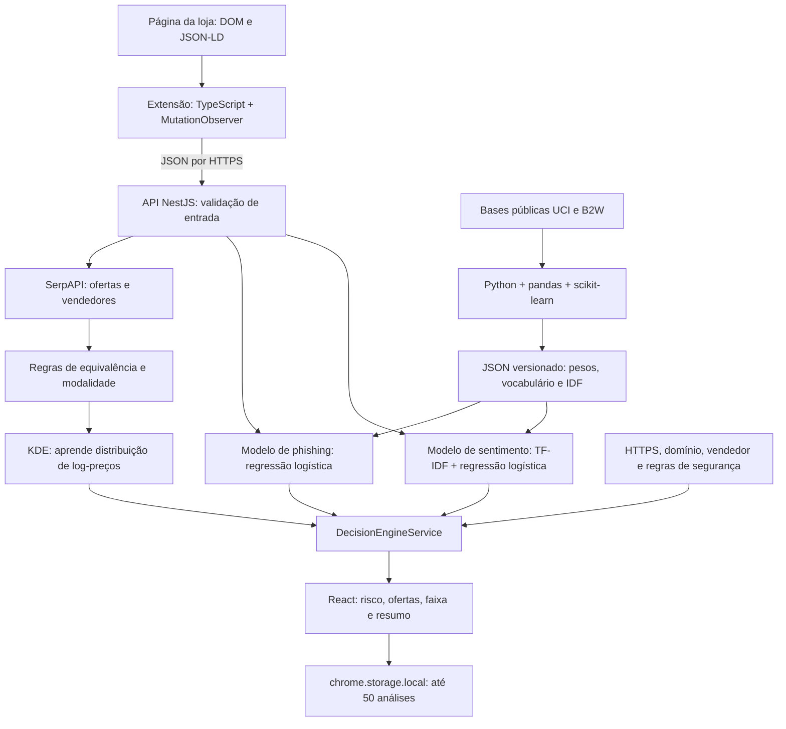

# Arquitetura

## Ferramentas por responsabilidade

| Ferramenta | Uso |
| --- | --- |
| Chrome Manifest V3 | Carregamento e permissões da extensão |
| React, TypeScript e Tailwind | Interface e controle de estados |
| Seletores CSS e JSON-LD | Extração dos dados da página |
| MutationObserver | Releitura quando a loja renderiza novos dados |
| Node.js e NestJS | Rotas, serviços, validação e resposta |
| Axios e SerpAPI | Consultas externas de produtos e ofertas |
| Python, pandas, NumPy, SciPy, scikit-learn | Preparação, treinamento e avaliação |
| Inferência TypeScript | Reprodução dos modelos no servidor sem Python em produção |
| Jest, Supertest e Vitest | Testes de backend, API e frontend |
| Obsidian e Markdown | Documentação local com links e diagramas |

## Fronteiras

- O navegador coleta dados; não recebe a chave da SerpAPI.
- O treinamento é uma atividade offline explícita; a API não abre um endpoint público de treinamento.
- Os artefatos são carregados uma vez pelo serviço. Não se usa pickle ou execução de Python por requisição.
- A resposta inclui os estados dos modelos. O frontend compatível com API antiga não transforma uma resposta antiga em previsão de ML.
- Textos explicativos são montados no código. Não há LLM na geração da resposta.

Relacionadas: [[07 - Treinamento e reprodução]], [[09 - Contrato da API]].
